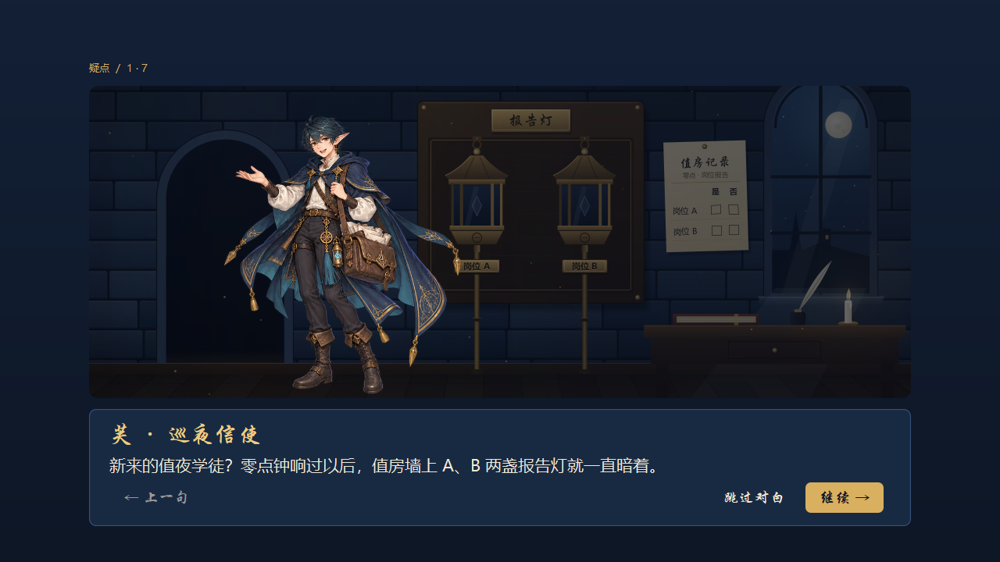
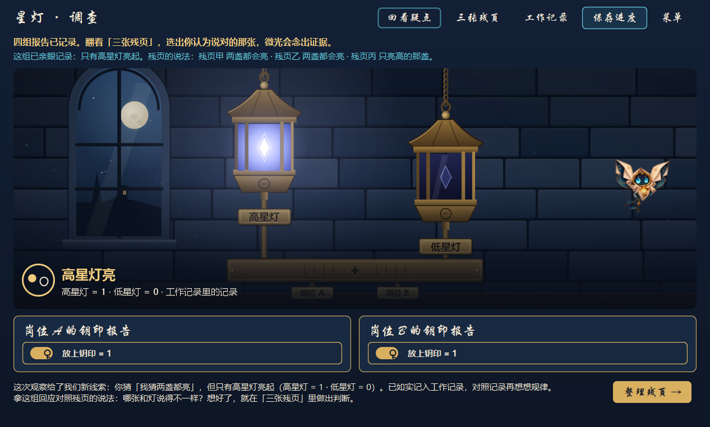
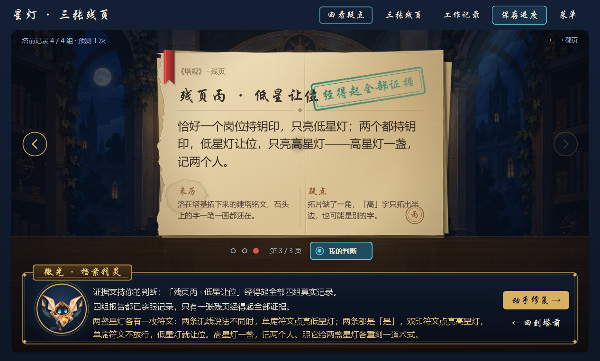
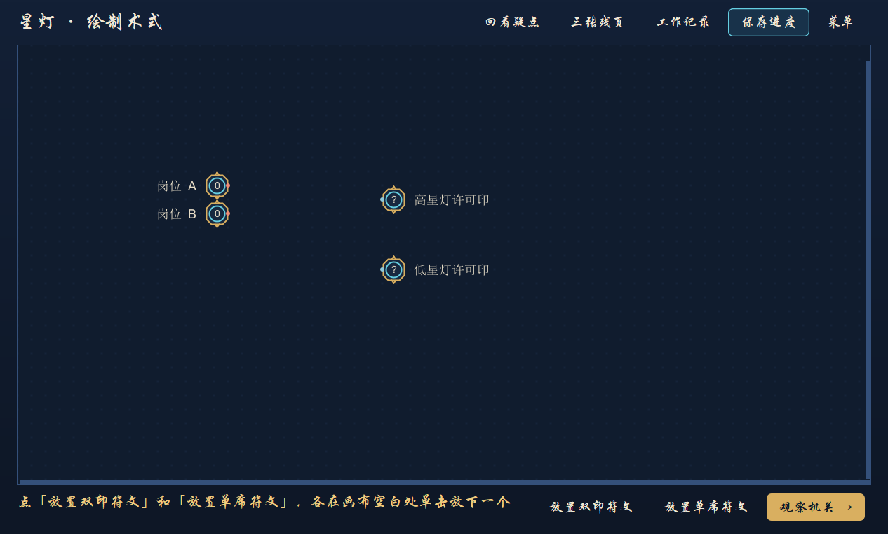
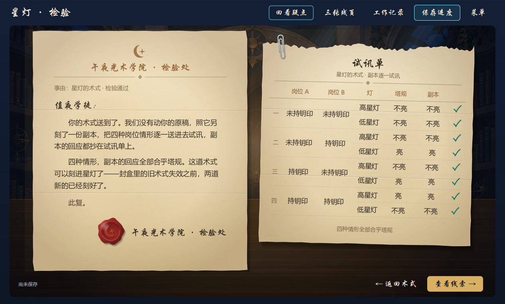
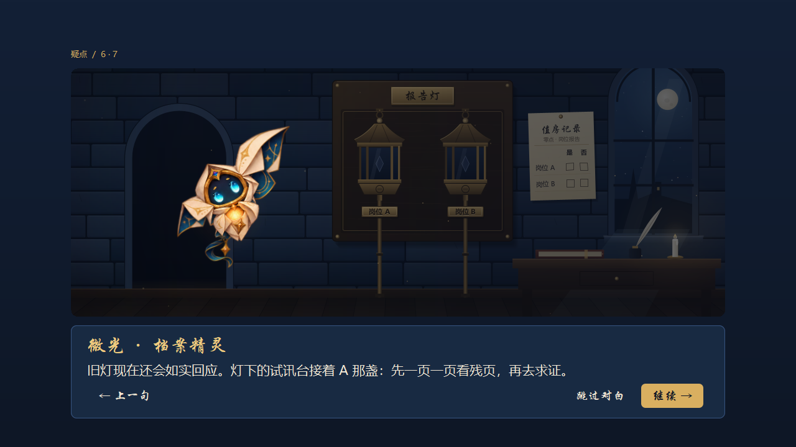

# 午夜光术学院 · Nightwatch Messenger

**一款通过实验发现数字逻辑规则的原创调查游戏。** 玩家作为值夜学徒，和信使芙、档案精灵微光、守档人洛核对互相矛盾的记录：改变钥印报告、预测机关回应、用反例排除解释，再亲手修复术式。

参赛选题：[The Midnight Academy](https://ai.bnbuacm.xyz/)。当前交付为 **2026-10-13 五章与角色动态更新版**，Windows 桌面优先，基于 Digital Java/Swing；游戏运行不调用 AI，也不需要联网。

## 下载与启动

1. 到 [本次版本 Release](https://github.com/3785870235/nighwatch-messenger/releases/tag/competition-2026-10-13-motion) 下载 **MidnightLogicAcademy-Competition-Windows-x64.zip**。
2. 完整解压到可写目录，双击 **Run-Academy.cmd**。已包含 Java 运行环境，无需安装 Java、Maven 或另下源码。
3. 首页「开始探索」后五章全部可直接选择；已通过章节有标记。仍可在通关回信进入下一章，也可进入自由工坊。
4. **手动保存**：使用菜单中的保存或修复时 Ctrl+S。观察、预测、通关不自动存档；退出可保存、放弃或取消。个人数据位于解压目录的 `work/`。

不要在 ZIP 内直接运行。仓库源码附带同版 `app/Digital.jar`，但 Code ZIP 不带 Java；本机已有 Java 11+ 时可用同一启动器。

## 功能实现状态

| 功能 | 状态 | 对应实现/资源 |
|---|---|---|
| 五章实验、候选解释、修复与剧情线索 | 已实现；自动化流程已验证 | [关卡资源](levels/)、[调查判定](digital-source/src/main/java/de/neemann/digital/academy/Investigation.java) |
| 第一章报告灯：成立、否与无讯 | 已实现 | [第一章](levels/01_report_light/) |
| 第二章提醒灯：反相规则 | 已实现 | [第二章](levels/02_reminder_light/) |
| 第三章档案门：双印规则 | 已实现 | [第三章](levels/03_archive_gate/) |
| 第四章受理灯：恰好一份成立 | 已实现 | [第四章](levels/04_registry_desk/) |
| 第五章星灯：高低两灯表示数量（半加器） | 已实现；两个输出独立验证 | [第五章](levels/05_star_lamps/) |
| 五章直接开放、通过标记、通关直达下一章、最终回到学院 | 已实现 | [首页和章节衔接](digital-source/src/main/java/de/neemann/digital/academy/AcademyHome.java) |
| 自由工坊、元件搭建、实际连线与运行 | 已实现，复用 Digital | [应用窗口](digital-source/src/main/java/de/neemann/digital/gui/Main.java) |
| 手动保存、另存为、取消与失败保护 | 已实现；不自动保存 | [进度](digital-source/src/main/java/de/neemann/digital/academy/AcademyProgress.java)、[保存策略](digital-source/src/main/java/de/neemann/digital/academy/AcademySavePolicy.java) |
| 分屏对白、可后退及跳过的小课、动态序幕、音效 | 已实现；Esc跳整段，空格跳当前幕 | [过场](digital-source/src/main/java/de/neemann/digital/academy/AcademyCinematic.java)、[声音](digital-source/src/main/java/de/neemann/digital/academy/AcademySound.java) |
| 首页灯光/星光/流星、精灵纸翼与鼠标注视 | 已实现 | [首页动态](digital-source/src/main/java/de/neemann/digital/academy/AcademyHomeMotion.java)、[角色](digital-source/src/main/java/de/neemann/digital/academy/AcademyCharacters.java) |
| 芙/洛第二组姿态 | 已接入部分章节台词 | [姿态检查](digital-source/src/test/java/de/neemann/digital/academy/StoryPoseTest.java) |
| 微光八姿态、芙/洛走入场景与说话口型 | 已实现程序动画 | 原画程序形变，非逐帧手绘或语音对口型；微光偷看/困惑姿态不跟鼠标 |
| 演示视频 | **待团队录制补充** | [3分钟录制指南](docs/DEMO_RECORDING_GUIDE.md)；指南不是已完成视频 |

五章剧情有阶段性结尾，保留“谁改记录、为何改动”等未知，不虚构已经找到责任人。已知限制包括第三章部分姿态仍按默认选择、信封封口美术存在差异、尚无完整人工逐关试玩与高DPI全覆盖验证。

## 核心玩法与扣题说明

以档案门为例，三张残页分别声称任一份、两份、恰好一份报告成立时开门。玩家选择输入组合、先预测再观察；候选解释也由真实 Digital 模型给出预测。已观察到的反例才能排除解释，未观察与无效讯息不充当支持证据。规律稳定，不随剧情改写。

发现后还要实际连线，独立检验各组条件；通关线索来自本次验证，历史通过不能替代当前正确性。第五章通过两盏灯区分1与2，把前面所学用于数量表达。真实知识因此直接决定可操作规则和调查进展。

## 实际运行画面

以下是本次发布构建在实际 Swing 窗口中的自动化操作截图，不是概念图；截图使用临时演示进度。









## 设计决策、实用性与相近作品

面向刚接触 Computer Organization 的学生：用短步骤、可回看的教程和具体反例，练习输入输出、NOT、AND、XOR及半加器。当前没有学习效果的对照研究，不声称提升了多少成绩。

| 相近项目 | 已有重点 | 本项目的具体差异与取舍 |
|---|---|---|
| [Digital](https://github.com/hneemann/Digital) | 教育用途的数字逻辑设计、仿真、编辑与测试工具 | 直接复用其底座，新增五章叙事调查、残页假说比较、预测记录、证据门槛、章节衔接和魔法界面。没有宣称重写仿真器。 |
| [Turing Complete](https://turingcomplete.game/) | 从逻辑门、部件逐步构建计算机和汇编 | 本作聚焦短篇调查：比较互相冲突的记载，选择实验、查找反例、修复并获得线索；首版止于半加器，不追求搭完整CPU。 |

复用 Digital 降低编辑、端点与仿真出错的风险，也限制了界面技术为 Swing 和部分原生操作。程序动效与逻辑求值分离，装饰流光不代表物理传播时间。完整设计取舍见 [架构与证据](docs/ARCHITECTURE_AND_EVIDENCE.md)。

## 核心文件清单

| 文件 | 作用 |
|---|---|
| [AcademyMain.java](digital-source/src/main/java/de/neemann/digital/academy/AcademyMain.java) | 程序入口 |
| [AcademyPanel.java](digital-source/src/main/java/de/neemann/digital/academy/AcademyPanel.java) | 实验、修复、验证和页面组织 |
| [LevelDefinition.java](digital-source/src/main/java/de/neemann/digital/academy/LevelDefinition.java) | 关卡资源与输出定义 |
| [ReferenceDevice.java](digital-source/src/main/java/de/neemann/digital/academy/ReferenceDevice.java) | 用真实 Digital 模型运行参考装置 |
| [ExperimentSession.java](digital-source/src/main/java/de/neemann/digital/academy/ExperimentSession.java) | 观察、预测和有效性 |
| [Investigation.java](digital-source/src/main/java/de/neemann/digital/academy/Investigation.java) | 候选预测与反例核对 |
| [LevelValidator.java](digital-source/src/main/java/de/neemann/digital/academy/LevelValidator.java) | 独立验证玩家术式 |
| [academy 测试目录](digital-source/src/test/java/de/neemann/digital/academy/) | 单测与独立GUI流程检查 |
| [WORLD_BIBLE.md](docs/WORLD_BIBLE.md) | 原创人物、五章故事与已知/未知边界 |
| [AI_USAGE.md](AI_USAGE.md)、[ai-logs](ai-logs/) | AI使用说明与真实对话节选 |

## 构建与验证

开发需 Java 11+ JDK 与 Maven 3.x，设置 `JAVA_HOME` 后在 PowerShell 运行：

```powershell
.\tools\Build-Academy.ps1
```

首次构建需要下载 Maven 依赖；试玩不需要。构建成功后会更新 `app/Digital.jar`。

发布前重新运行 **880项单元测试，全部通过**。本次采用09:23完整package后的JAR，用便携Java和该JAR复核五章直接开放及章节衔接，并额外重跑10组GUI检查，避免测试类目录掩盖产品JAR。具体命令、通过数和验证边界见 [VALIDATION.md](docs/VALIDATION.md)。不把自动化操作描述为人工通关。

## 开源、AI与比赛新增范围

底座为 [hneemann/Digital v0.31](https://github.com/hneemann/Digital/tree/v0.31)，基线提交 `816eff502ed582c0c15e98c6344f7d30677bdfc2`。保留源码、版权、依赖声明及 [GPL-3.0许可](LICENSE)。可运行JAR对应本仓库源码。

项目新增部分为学院模块、相关上游窗口接入、五章资源、原创世界/人物、美术包装、动态声音与测试。开发辅助使用 Codex、Claude Code 和图像生成；运行时不调用模型。详见 [AI_USAGE](AI_USAGE.md) 与 [来源声明](docs/ATTRIBUTION.md)。

游戏使用系统字体回退，不分发商业系统字体。便携包保留 Temurin/OpenJDK 11 的 `runtime/legal/` 和 `NOTICE`。仓库与包不包含个人存档、凭据、内部memory或无关会话。
